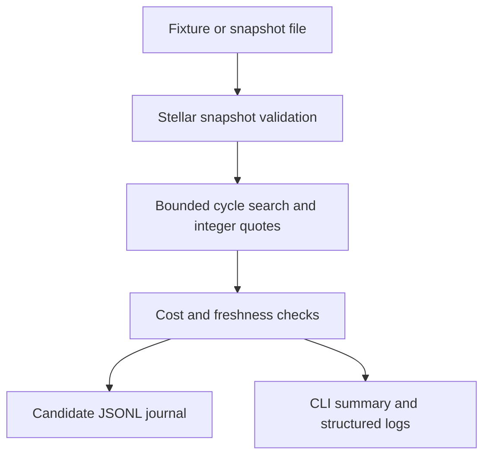

# Architecture

Omnigne keeps routing math separate from chain execution. The initial runtime is a one-shot paper scanner; the long-running service and live adapters follow in later milestones.

This diagram describes implemented behavior. The following boundaries reserve space for live integrations:

| Boundary | Implemented | Planned |
| --- | --- | --- |
| Core | Chain-qualified asset ids, snapshot validation, constant-product quotes, simple cycle search | Additional venue curves, Bellman-Ford candidate search, size optimization |
| Risk | Input cap, positive minimum profit, state age, estimated fee and buffer subtraction | Inventory reservations, portfolio exposure, fee valuation, circuit breakers |
| Storage | Single-writer candidate journal | Durable submission state, cursor backfill, authoritative balance reconciliation |
| Stellar | Validated JSON snapshots | SDEX and Soroban data sources, transaction builders, RPC simulation, sequence handling |
| EVM | Network identifiers | Alloy clients, fees and nonce handling, venues, flash loans, reorganization recovery |
| Intents | Unsigned terms and structural checks | Signatures, cancellation, cumulative fills, distribution partners and settlement |
| Contracts | Version-only Soroban contracts and a disabled EVM executor | Authorized execution and settlement with tested balance invariants |

## Execution domains

A snapshot contains one network and one execution domain. Snapshot validation rejects mixed Classic/Soroban pools and foreign-network assets. Pool ids are unique; repeated-pool routes are rejected.

Stellar Classic path-payment execution and Soroban contract execution need separate builders. Cross-chain intent fulfillment requires a separate asynchronous state machine and cannot become a single atomic path through this graph.

## Quote accounting

Constant-product quotes incorporate pool fees and rounding. The risk layer subtracts the supplied network-fee estimate and uncertainty buffer once. All amounts use the same settlement asset's base units. No flash borrowing is modeled by the current scanner.

The limits apply to paper candidates only. The candidate journal is not a transaction recovery database. Never use `RiskDecision.accepted` as sufficient authorization to execute a transaction.

## Live execution prerequisites

Implement consistent state ingestion, exact protocol math, funds reservation, policy-bound signing, recent chain simulation, on-chain checks, and transaction reconciliation before enabling live trading. Submitted, unknown, failed and confirmed states must survive restarts. Persist transaction identity before submission and reconcile timeouts before retrying.

