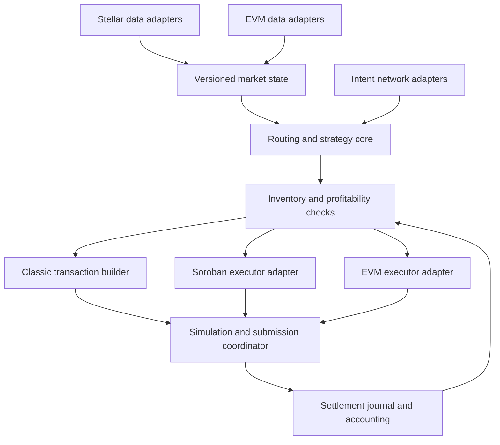

# Omnigne Technical Specification

**Status:** Proposed architecture. **Revision:** 20 November 2026.

Omnigne is a headless Rust engine for arbitrage, liquidations, and intent fulfillment, starting on Stellar and expanding to selected EVM networks. Its first milestone is a read-only opportunity scanner that measures executable routes and costs before live trading begins.

# Project Overview

Omnigne shares asset models, route discovery, inventory controls, and accounting across chain adapters. Each integration remains responsible for venue math, authentication, transaction construction, simulation, and settlement verification.

Revenue depends on executable liquidity, competition, financing costs, and operational reliability. Launching on a lower-fee network is a hypothesis to test rather than evidence that a profitable market exists.

# Corrections to the Original Assumptions

| Original assumption | Implementation requirement |
| --- | --- |
| Stellar eliminates fee competition and front-running risk. | Stellar has inclusion fees, smart-contract resource fees, and surge pricing. Budget for competing executions and failed submissions. [S1] |
| One Soroban executor combines SDEX operations and Soroban AMM calls. | Stellar smart-contract transactions contain one smart-contract operation. Design consequence: separate Classic path-payment execution from Soroban contract execution. SAC asset compatibility does not itself expose the SDEX as a callable contract. [S2] |
| A profit assertion guarantees zero loss. | Reversion rolls back covered application changes. Network fees can remain payable, and a contract balance check does not establish total wallet or portfolio profit. [S1, S2] |
| Blend liquidations guarantee a 5%–10% bonus. | Blend uses auctions. Model acquired collateral, assumed liabilities, and executable unwind proceeds for the deployed version. [S3] |
| Flash liquidity is only available in the EVM phase. | Blend v2 exposes flash loans. Verify the target pool, asset, callback flow, repayment semantics, and liquidity. [S3, S4] |
| Solvers retain all positive slippage. | User terms and protocol rules govern fees, surplus, rewards, and penalties. CoW participation includes bonding; UniswapX distinguishes quoters and fillers. [S7, S8] |
| One EVM adapter unlocks every L2. | Reuse code, then validate deployments, liquidity, fee models, sequencer behavior, and settlement separately for each network. |
| Cross-chain fulfillment is another atomic route. | Use an asynchronous process with source verification, destination delivery, deadlines, refunds, recovery, and rebalancing. |

# Initial Product Scope

Start with one Stellar execution domain, a small asset allowlist, and two venue implementations with overlapping liquidity. Select venues after inspecting current deployments and interfaces. Soroswap and Aquarius are candidates rather than confirmed integrations.

For Soroban execution, every swap leg must be callable within one contract invocation tree. Classic execution instead builds native path-payment transactions. Both reuse market models while maintaining distinct route eligibility and transaction builders.

Implement read-only scanning, then paper execution, then a limited live pilot. Liquidations, public intent intake, EVM networks, and cross-chain fulfillment follow later. Alert delivery and treasury sweeps remain configurable capabilities with explicit destinations and operator policy.

# System Architecture



The coordinator delegates simulation and submission to the selected chain implementation. Cross-chain fulfillment uses a separate coordinator.

## Proposed Workspace

| Component | Responsibility |
| --- | --- |
| `omnigne-core` | Chain-qualified assets, amounts, quotes, graph traversal, and strategy interfaces. |
| `omnigne-risk` | Inventory reservations, position limits, fee budgets, stale-state rejection, and circuit breakers. |
| `omnigne-stellar` | Ingestion, Classic and Soroban execution domains, sequence handling, simulation, and reconciliation. |
| `omnigne-evm` | Alloy connectivity, nonce management, fee estimation, simulation, and reorganization handling. |
| `omnigne-intents` | Protocol-specific order ingestion, validation, auction participation, and settlement. |
| `omnigne-runner` | Headless process, configuration, signing interface, scheduling, and health endpoints. |
| `omnigne-storage` | Durable cursors, transaction journal, fills, balance reconciliation, and accounting. |
| `contracts/stellar-executor` | Allowlisted Soroban swaps with strategy-specific checks. |
| `contracts/stellar-settler` | Future user authorization, settlement, and fill accounting. |
| `contracts/evm` | Future Solidity executor, venue integrations, and financing callbacks. |

Use `tokio`, `serde`, and structured tracing off chain, with `petgraph` for candidate traversal. Use `soroban-sdk` for Stellar contracts and Foundry for EVM tests. Pin compatible toolchain and dependency versions when implementation starts.

# Market State and Routing

## Asset and Quote Identity

Identify each asset by network and issuer or contract address. Symbols such as `USDC` are display metadata; matching symbols do not establish asset equivalence. Explicitly verify mappings between Stellar Classic assets and SAC representations.

Store amounts in integer base units with checked arithmetic and decimal metadata. Every quote includes input amount, output amount, venue, fees, execution domain, state version, and expiry.

## Consistent Ingestion

Persist ledger or block cursors and build consistent snapshots. Use streams or polling supported by each provider, and periodically reconcile missing updates. Backfill after startup or subscription gaps before evaluating opportunities.

Track EVM block hashes and invalidate affected state after reorganizations. On Stellar, align independent sources to a compatible ledger watermark. Disable stale or incomplete venues. Measure ledger cadence and RPC latency instead of assuming fixed block times.

## Candidate Discovery and Exact Sizing

Bellman-Ford with `-ln(effective marginal rate)` edge weights can find candidate cycles. Marginal rates do not establish finite-size executable profit, and approximate search need not find every opportunity.

Evaluate candidates with exact venue math. Constant-product pools, stable pools, concentrated-liquidity pools, and order books require distinct implementations. Include fees and rounding at every hop. If a route revisits a pool, apply reserve changes from earlier legs.

Search bounded input sizes, simulate the full route, and reject candidates below the required net return. Intent routing reuses quotes while adding order constraints, auctions, and potentially route splitting.

## Execution Domains

| Domain | Permitted atomic route |
| --- | --- |
| Stellar Classic | Supported native path-payment paths through order books and Classic pools. |
| Stellar Soroban | Supported contract calls within one invocation tree. |
| One EVM network | Supported calls and optional flash financing within one transaction. |
| Multiple networks | A separately specified asynchronous fulfillment process. |

# Profitability and Execution Lifecycle

For a cyclic route with the same start and end asset:

```text
expected_net_trade_profit =
    exact_route_output
  - trade_input
  - financing_cost_not_already_included
  - estimated_network_cost_in_start_asset
  - other_execution_costs
  - uncertainty_buffer
```

Include venue fees, price impact, and rounding in the quoted output without subtracting them twice. Convert network fees conservatively using fresh, independently checked valuation; reject execution when valuation is unreliable.

Strategy accounting includes unsuccessful-attempt fees, financing outside individual trades, inventory valuation changes, and allocated operating costs. Separate realized trade profit, marked portfolio performance, and operating profit.

1. **Observe:** Build a consistent snapshot and discover eligible candidates.

2. **Reserve:** Reserve inventory and an execution slot to prevent concurrent overspending.

3. **Quote:** Calculate exact outputs, financing obligations, fees, and a conservative profit threshold.

4. **Simulate:** Use recent state. For Soroban, obtain resources, footprint, and authorization requirements from RPC simulation, then validate the fully authorized transaction. [S5]

5. **Authorize:** Bind signing to the network, executor, route, limits, expiry, and recipient.

6. **Submit:** Persist transaction identity before submission. Track pending, included, expired, failed, and unknown outcomes.

7. **Reconcile:** Verify authoritative settlement and balance changes before releasing reservations or retrying uncertain operations.

8. **Account:** Record fees, received assets, debt changes, and realized results; issue configured alerts.

A timeout is not proof of failure. Reconcile the original transaction before creating another economic action. Stop new submissions after repeated failures, excessive fees, state divergence, or an operator-defined loss limit.

# Contract Requirements

## Soroban Arbitrage Executor

Validate the authorized caller, allowlisted route, input limits, expiry, and settlement asset. Record balances before moving strategy funds. Check final balances after route legs and financing obligations are accounted for.

For a narrowly scoped cyclic strategy with all funding represented in recorded balances:

```text
require(min_profit > 0)
require(final_settlement_balance >= initial_settlement_balance + min_profit)
require(no_unapproved_asset_depletion)
require(no_unapproved_new_liabilities)
```

If repayment is pulled after a callback, check profit after the pull completes or reserve the full remaining principal and premium. Temporarily inflated callback balances cannot count as profit. Aave's repayment flow illustrates this distinction. [S6]

Account explicitly for external top-ups; user deposits and unrelated funding cannot become trading profit. Restrict recipients, spending authority, and callable contracts. Reject unsupported token behaviors. Treasury transfers follow the check or are explicitly included in its accounting.

These invariants cover the configured assets and liabilities in one transaction. The off-chain guard separately accounts for network fees and broader economics.

## Classic Execution

Use native transaction constraints rather than a Soroban assertion. For an eligible cyclic strict-send path, match destination and source assets and require a destination minimum covering input plus the required token gain. Account for network fees off chain. Verify that the precise path and asset combination is supported before enabling it.

## Intent Settlement

Authenticate the user and bind signed terms to network, settler, assets, input limit, minimum output, recipient, nonce, expiry, fees, and partial-fill policy. Enforce cancellation, replay protection, and cumulative fills on chain.

Satisfy user terms before assigning solver revenue. External intent protocols retain their settlement and authorization contracts; a generic Omnigne settler does not replace them.

## EVM Execution

Use a small executor and narrowly reviewed venue adapters. Validate lender identity, callback sender, initiator, active execution context, repayments, approvals, and protected balances. Test valid callbacks alongside unauthorized calls and reentrancy attempts. Read live lender premiums and reserve eligibility rather than assuming permanent fees or universal availability. [S6]

# Liquidations and Intent Networks

**Blend:** Use a version-specific adapter for borrower positions, oracle inputs, pool configuration, and auctions. Quote fills at the intended execution ledger, including debt assumed and its executable repayment cost. Initially require a complete atomic unwind with no residual debt. Carrying collateral and liabilities after a fill requires a separate portfolio-risk model. Use the current contract interface rather than legacy function names. [S3, S4]

**Stellar intents:** Confirm a partner, order format, authentication flow, and distribution channel before exposing a solver API. An endpoint alone does not create order flow. Define whether Omnigne quotes, fills from inventory, routes, or combines these activities.

**CoW Protocol:** Implement admission, bonding, competition rules, rewards, penalties, and settlement as a dedicated integration. User surplus is not automatically solver revenue. [S7]

**UniswapX:** Implement deployed order and reactor versions on a selected supported chain. Respect exclusivity and auction timing; filler access and quoter admission differ. Recheck deployments when integration starts. [S8]

# Infrastructure and Operations

Run a headless Linux service with configurable RPC endpoints, durable journal, structured logs, health checks, and Prometheus metrics. Add Grafana and configured Telegram or Discord alert adapters as operational needs develop.

Size hardware using snapshot memory, indexing throughput, route-search latency, simulation throughput, and provider limits. Validator proximity alone does not guarantee execution latency. Justify self-hosted nodes with measured bottlenecks.

Isolate signing behind policy checks. Cap inventory and fee balances, separate treasury withdrawal authority, and redact secrets. A compromised trading key can expose accessible funds despite route checks. Sweep configured treasury amounts only after reconciliation.

Monitor state age, RPC errors, quote-to-inclusion delay, simulation failures, submission outcomes, failure fees, realized PnL, inventory exposure, daily loss-budget usage, and Soroban storage TTL requirements.

# Phased Roadmap

## Phase 0 Validate the Market

- [ ] Select one execution domain and verify deployed asset and venue identities.

- [ ] Inspect liquidity and collect replayable snapshots over a representative period.

- [ ] Identify atomic routes with exact quotes and realistic costs.

- [ ] Report trade size, state age, expected net return, and sensitivity to competition.

**Acceptance:** Demonstrate plausible executable opportunities before live execution infrastructure. Paper results are estimates rather than realized returns.

## Phase 1 Stellar Arbitrage

- [ ] Implement the core, two verified venue adapters, and durable ingestion.

- [ ] Add bounded search, exact sizing, paper mode, and risk controls.

- [ ] Implement the selected transaction builder or Soroban executor.

- [ ] Verify profitable settlement and rejection of stale, unprofitable, unauthorized, and malformed executions.

- [ ] Verify reservations, crash recovery, uncertain outcomes, and fee accounting.

- [ ] Complete controlled integration tests and readiness review before a limited mainnet pilot.

**Acceptance:** Reconcile every pilot attempt and balance movement; verify operational limits stop submissions. Testnet behavior does not establish mainnet profitability.

## Phase 2 Blend Liquidations and Stellar Intents

- [ ] Implement auction indexing and version-specific liquidation quotes.

- [ ] Test repayment, collateral unwind, auction changes, and no-residual-liability checks.

- [ ] Evaluate Blend v2 flash financing separately from inventory-funded execution.

- [ ] Confirm an intent partner and implement signed terms, cancellation, replay protection, and partial fills.

**Acceptance:** Validate liquidation economics and user settlement invariants independently.

## Phase 3 EVM Expansion

- [ ] Select one network based on measured liquidity and economics.

- [ ] Add Alloy connectivity, chain-specific fees, nonce handling, and reorganization recovery.

- [ ] Test one financing provider and a small venue set on pinned-state Foundry forks.

- [ ] Validate callbacks, repayments, adversarial token behavior, and accounting.

- [ ] Add a second network and one intent protocol after the first integration stabilizes.

**Acceptance:** Maintain deployment and capability records per network; shared bytecode does not establish equivalent behavior.

## Phase 4 Cross Chain Fulfillment

- [ ] Define source escrow or payment proof, destination delivery, settlement transport, finality, deadlines, refunds, and recovery.

- [ ] Require authenticated source funding before delivery unless an explicit pre-funding risk policy permits otherwise.

- [ ] Track destination inventory, outstanding claims, and rebalancing costs.

- [ ] Test duplicate deliveries, delayed messages, reorganizations, failed claims, and outages.

**Acceptance:** Recover from every intermediate state before offering fast fulfillment. Fees must cover inventory, finality, transport, and rebalancing exposure.

# Immediate Build Target

Build a Stellar scanner that records each candidate's snapshot identifier, execution domain, asset identities, venue sequence, input size, exact quoted output, estimated costs, financing assumptions, expiry, and accept or reject reason.

Use these records to validate the first execution strategy and create the fixtures for executor development.

# Primary References

Recheck target deployments, contract code, and network settings during implementation.

- **[S1]** [Stellar fees and resource limits](https://developers.stellar.org/docs/learn/fundamentals/fees-resource-limits-metering).

- **[S2]** [Stellar operations and transactions](https://developers.stellar.org/docs/learn/fundamentals/transactions/operations-and-transactions).

- **[S3]** [Blend whitepaper with v2 differences and liquidation auctions](https://docs.blend.capital/blend-whitepaper).

- **[S4]** [Blend v2 pool contract interface](https://github.com/blend-capital/blend-contracts-v2/blob/main/pool/src/contract.rs).

- **[S5]** [Stellar RPC simulateTransaction](https://developers.stellar.org/docs/data/apis/rpc/api-reference/methods/simulateTransaction).

- **[S6]** [Aave v3 flash loans](https://aave.com/docs/aave-v3/guides/flash-loans).

- **[S7]** [CoW Protocol solvers](https://docs.cow.fi/cow-protocol/concepts/introduction/solvers).

- **[S8]** [UniswapX fillers overview](https://developers.uniswap.org/docs/liquidity/uniswapx/filling/overview).

